# ERD Basis Data · Satgas Soedirman

Rancangan basis data untuk aplikasi operasional Satgas Soedirman (PostgreSQL di Supabase).

**Sumber rancangan**

1. Bagan struktur organisasi (acuan garis komando bila bertentangan dengan diagram).
2. Diagram aktivitas T01–T04 dan T06–T09.
3. Proyek `yafidsa`: bentuk data di `src/lib/types.ts`, paket izin di `src/lib/permissions.ts`, mesin status di `src/lib/status.ts`, matriks di `src/lib/penugasan.ts`, dan aturan server contoh di `src/mocks/server/`.
4. Rancangan UI halaman Masuk dan Lupa password.

**Isi:** 41 tabel dalam 6 kelompok (43 setelah penyesuaian implementasi; lihat bagian Penyesuaian saat implementasi). Setiap kelompok punya satu diagram; tabel dari kelompok lain tampil sebagai kotak tanpa kolom.

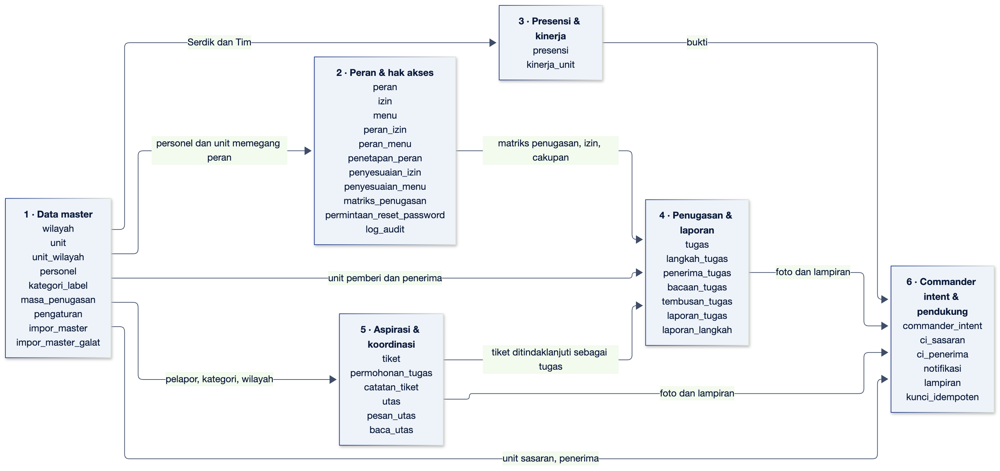

Sumber diagram (Mermaid)

<!-- erd:0-ikhtisar -->
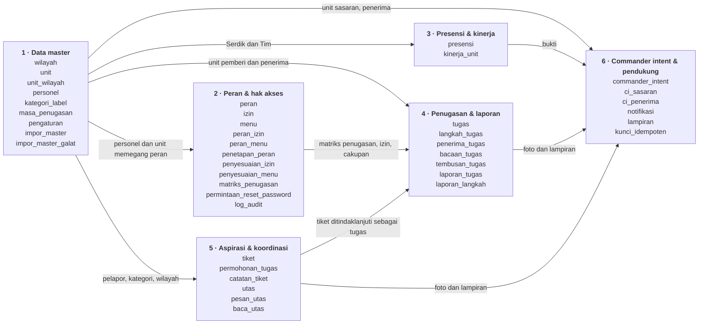

## Konvensi

- **Nama** tabel dan kolom berbahasa Indonesia, huruf kecil dengan garis bawah, mengikuti istilah di `yafidsa`.
- **Kunci utama** bertipe `uuid`, kecuali tabel rujukan yang memakai kode bermakna (`peran.id`, `izin.kode`, `menu.kunci`, `wilayah.kode`).
- **Waktu** disimpan sebagai `timestamptz` (UTC). Tanggal operasional (`presensi.tanggal`) adalah tanggal WIB.
- **Status** disimpan sebagai teks dengan `CHECK`; daftar nilainya mengikuti mesin status `yafidsa` (lihat bagian Status).
- **"Terlambat" bukan status**, melainkan hasil hitung dari tenggat, sama seperti di `yafidsa`.
- **Berkas** (foto, lampiran, PDF) disimpan di Supabase Storage; basis data hanya menyimpan jalurnya.
- **Akun** masuk dikelola Supabase Auth (`auth.users`); `personel.akun_id` menghubungkannya.

## 1 · Data master (T08)

Dikelola Admin lewat input manual atau impor CSV/Excel. Dipakai semua modul.

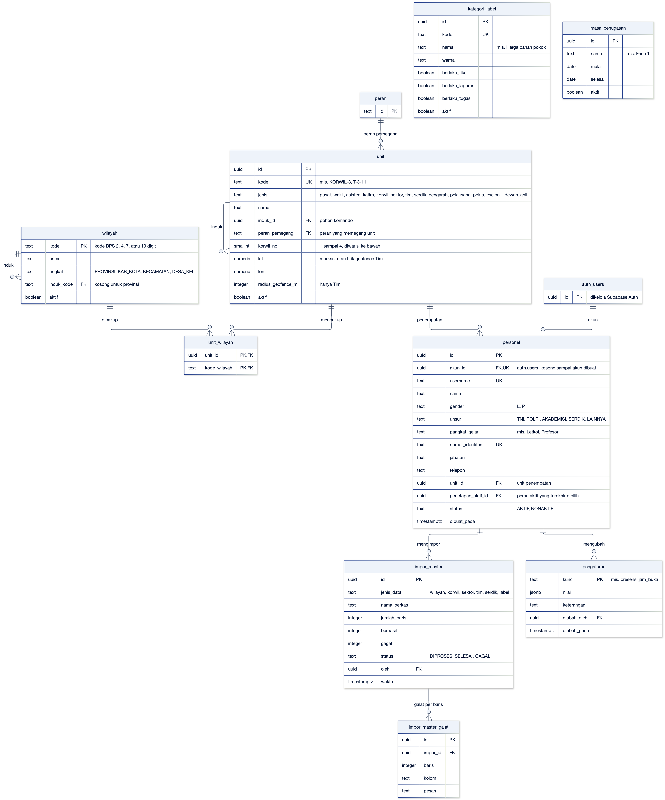

Sumber diagram (Mermaid)

<!-- erd:1-data-master -->
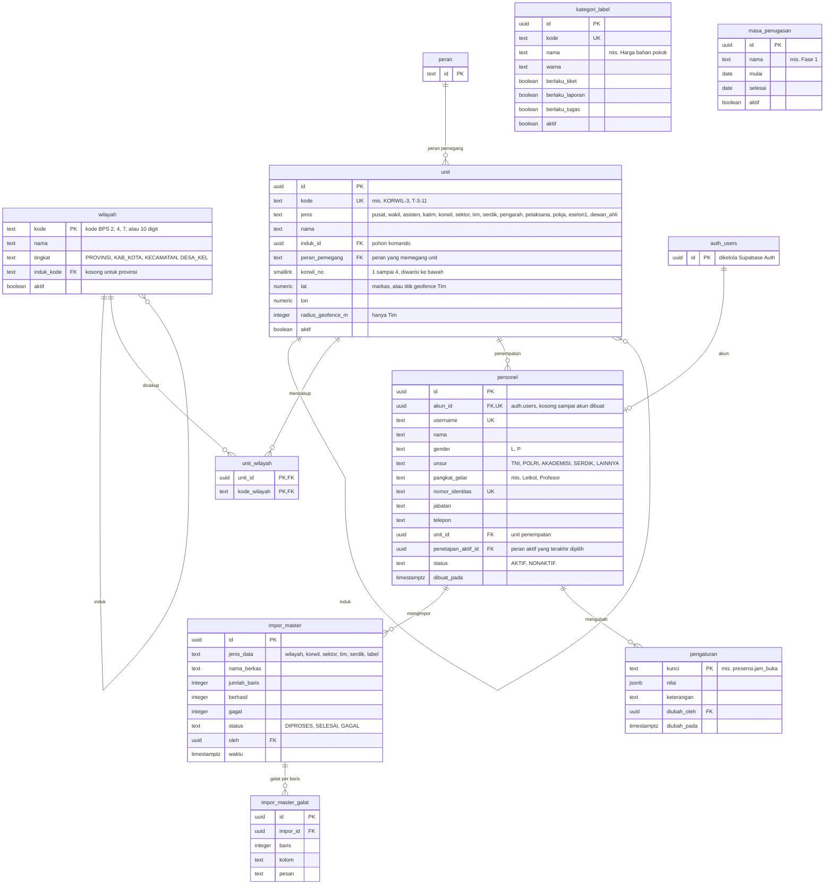

**Aturan penting**

- **`unit` adalah satu pohon untuk seluruh struktur.** Korwil dan Wakil Komandan sama-sama berinduk ke unit `pusat` (Komandan Satgas), sesuai bagan organisasi. Di `yafidsa` Korwil masih berinduk ke Wakil Komandan; ini perlu diperbaiki di data, bukan di skema.
- **Jenis `katim` disediakan tetapi belum dipakai.** Tiga Katim di bagan (Data & IT, Anev, Konten & Layanan) belum dimasukkan. Bila nanti dibutuhkan, cukup menambah satu baris `peran`, tiga baris `unit` di bawah Wakil Komandan, paket izinnya di `peran_izin`, dan barisnya di `matriks_penugasan`; tidak ada perubahan struktur tabel.
- **Setiap Serdik punya satu unit berjenis `serdik`** di bawah Tim, sama seperti di `yafidsa`. Dengan begitu tugas, tembusan, dan cakupan data selalu merujuk unit, dan berpindah otomatis ke pemegang baru bila personel diganti.
- **Pemegang unit tidak disimpan di `unit`.** Pemegang adalah personel dengan `penetapan_peran` aktif pada unit itu (lihat kelompok 2). Anggota Tim adalah pemegang unit `serdik` di bawahnya.
- **`unit_wilayah`** memetakan cakupan ke kode BPS: Korwil ke provinsi (Korwil II mencakup dua provinsi), Sektor ke kab/kota, Tim ke kecamatan atau desa. Wilayah anak harus berada di dalam wilayah induk.
- **Geofence Tim** = `lat`, `lon`, `radius_geofence_m`. `yafidsa` memakai radius 1.500 m dan akurasi maksimal 50 m.
- **`pengaturan`** menyimpan nilai operasional yang di `yafidsa` masih berupa konstanta: jendela check-in 05.00–09.00 WIB, tenggat verifikasi 2 jam, SLA telaah tiket 24 jam (4 jam bila mendesak), tenggat tanggapan utas 24 jam, tenggat terima tugas 2 jam.
- **`kategori_label`** menggantikan daftar kategori tetap di `yafidsa` (8 kategori aspirasi) dengan data yang bisa dikelola Admin.
- **Validasi impor** (T08): kode BPS sah dan berjenjang, rantai induk utuh, kode label dan identitas personel unik. Galat dicatat per baris di `impor_master_galat`.

## 2 · Peran & hak akses · administrasi sistem (T09, T08)

Hanya Komandan Satgas definitif yang mengubah tabel di kelompok ini. Admin tidak punya akses ke sini.

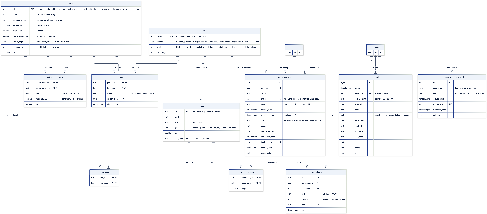

Sumber diagram (Mermaid)

<!-- erd:2-peran-hak-akses -->
```mermaid
erDiagram
  personel ||--o{ penetapan_peran : "memegang"
  peran ||--o{ penetapan_peran : "ditetapkan sebagai"
  unit ||--o{ penetapan_peran : "unit cakupan"
  peran ||--o{ peran_izin : "paket default"
  izin ||--o{ peran_izin : "termasuk"
  peran ||--o{ peran_menu : "menu default"
  menu ||--o{ peran_menu : "termasuk"
  izin ||--o{ menu : "syarat tampil"
  penetapan_peran ||--o{ penyesuaian_izin : "disesuaikan"
  izin ||--o{ penyesuaian_izin : "izin"
  penetapan_peran ||--o{ penyesuaian_menu : "disesuaikan"
  menu ||--o{ penyesuaian_menu : "menu"
  peran ||--o{ matriks_penugasan : "pemberi"
  peran ||--o{ matriks_penugasan : "penerima"
  personel ||--o{ permintaan_reset_password : "memproses"
  personel ||--o{ log_audit : "pelaku"

  peran {
    text id PK "komandan, plh, wakil, asisten, pengarah, pelaksana, korwil, sektor, ketua_tim, serdik, pokja, eselon1, dewan_ahli, admin"
    text label "mis. Komandan Satgas"
    text cakupan_default "semua, korwil, sektor, tim, diri"
    boolean sementara "benar untuk PLH"
    smallint maks_hari "PLH 30"
    smallint maks_pemegang "komandan 1, asisten 5"
    text unsur_wajib "mis. ketua_tim: TNI, POLRI, AKADEMISI"
    text kelompok_nav "serdik, ketua_tim, pimpinan"
    boolean aktif
  }
  izin {
    text kode PK "modul.aksi, mis. presensi.verifikasi"
    text modul "beranda, presensi, ci, tugas, aspirasi, koordinasi, kinerja, analitik, organisasi, master, akses, audit"
    text aksi "lihat, absen, verifikasi, koreksi, tambah, langsung, ubah, nilai, buat, telaah, kirim, kelola, ekspor"
    text keterangan
  }
  menu {
    text kunci PK "mis. presensi, penugasan, akses"
    text label
    text jalur "mis. /presensi"
    text grup "Utama, Operasional, Analitik, Organisasi, Administrasi"
    smallint urutan
    text izin_kode FK "izin yang wajib dimiliki"
  }
  peran_izin {
    text peran_id PK, FK
    text izin_kode PK, FK
    text cakupan "semua, korwil, sektor, tim, diri"
    uuid diubah_oleh FK
    timestamptz diubah_pada
  }
  peran_menu {
    text peran_id PK, FK
    text menu_kunci PK, FK
  }
  penetapan_peran {
    uuid id PK
    uuid personel_id FK
    text peran_id FK
    uuid unit_id FK "unit yang dipegang, dasar cakupan data"
    text cakupan "semua, korwil, sektor, tim, diri"
    timestamptz berlaku_mulai
    timestamptz berlaku_sampai "wajib untuk PLH"
    text status "DIJADWALKAN, AKTIF, BERAKHIR, DICABUT"
    text alasan
    uuid ditetapkan_oleh FK
    timestamptz ditetapkan_pada
    uuid dicabut_oleh FK
    timestamptz dicabut_pada
    text alasan_cabut
  }
  penyesuaian_izin {
    uuid id PK
    uuid penetapan_id FK
    text izin_kode FK
    text efek "IZINKAN, TOLAK"
    text cakupan "menimpa cakupan default"
    uuid oleh FK
    timestamptz pada
  }
  penyesuaian_menu {
    uuid penetapan_id PK, FK
    text menu_kunci PK, FK
    boolean tampil
  }
  matriks_penugasan {
    text peran_pemberi PK, FK
    text peran_penerima PK, FK
    text jalur "BIASA, LANGSUNG"
    boolean wajib_alasan "benar untuk jalur langsung"
    boolean aktif
  }
  permintaan_reset_password {
    uuid id PK
    text username "tidak dirujuk ke personel"
    text status "MENUNGGU, SELESAI, DITOLAK"
    timestamptz dibuat_pada
    uuid diproses_oleh FK
    timestamptz diproses_pada
    text catatan
  }
  log_audit {
    bigint id PK
    timestamptz waktu
    uuid pelaku_id FK "kosong = Sistem"
    text pelaku_nama "salinan saat kejadian"
    text peran_aktif
    text modul
    text aksi "mis. tugas.ack, akses.ditolak, peran.ganti"
    text objek_jenis
    text objek_id
    text nilai_lama
    text nilai_baru
    text alasan
    text perangkat
    inet ip
  }
  personel {
    uuid id PK
  }
  unit {
    uuid id PK
  }
```

**Cara hak akses dihitung**

1. Pengguna memilih satu `penetapan_peran` berstatus AKTIF sebagai peran aktif (`personel.penetapan_aktif_id`). Pengguna berperan ganda, misalnya Wakil Komandan sekaligus PLH, punya beberapa baris.
2. Izin dasar diambil dari `peran_izin` untuk peran itu: kode izin beserta cakupannya.
3. `penyesuaian_izin` pada penetapan itu menambah (IZINKAN), mencabut (TOLAK), atau mempersempit cakupan izin. `penyesuaian_menu` menampilkan atau menyembunyikan menu.
4. Cakupan data diukur dari `penetapan_peran.unit_id`: `semua` = seluruh Satgas; `korwil`, `sektor`, `tim` = unit itu beserta semua turunannya di pohon `unit`; `diri` = unit itu saja.
5. Menu tampil bila ada di `peran_menu` (setelah penyesuaian) **dan** izin pada `menu.izin_kode` dimiliki.

Aturan ini ditegakkan di server (kebijakan RLS dan fungsi basis data), bukan hanya di tampilan.

**Aturan penting**

- **Hanya pemegang `komandan` aktif** yang boleh menulis ke `penetapan_peran`, `peran_izin`, `peran_menu`, `penyesuaian_*`, dan `matriks_penugasan`. PLH tidak boleh. Percobaan oleh peran lain ditolak dan dicatat sebagai `akses.ditolak`.
- **Paling banyak satu `komandan` AKTIF.** Penggantian Komandan definitif dilakukan di luar aplikasi (T09).
- **Batas dari `peran`:** Asisten paling banyak 5 pemegang aktif; PLH wajib punya `berlaku_sampai` paling lama 30 hari; unsur personel harus sesuai `unsur_wajib`.
- **Kedaluwarsa otomatis:** proses terjadwal mengubah penetapan yang lewat `berlaku_sampai` menjadi BERAKHIR, memberi tahu Komandan, dan mencatat log. Peran lain milik orang itu tetap berlaku.
- **Pencabutan atau penonaktifan akun** mengisi `dicabut_*`, mengubah status menjadi DICABUT, dan mengakhiri sesi Supabase Auth pengguna itu.
- **Personel baru dari Admin** belum punya `penetapan_peran`, jadi belum bisa membuka apa pun sampai Komandan menetapkan perannya (T08).
- **`matriks_penugasan`** menggantikan matriks yang ditulis tetap di `yafidsa/src/lib/penugasan.ts`, sehingga garis komando bisa disesuaikan tanpa mengubah kode. Isi awalnya ada di tabel di bawah.
- **`log_audit` hanya bisa ditambah.** Tidak ada izin ubah atau hapus untuk siapa pun, dan hanya izin `audit.lihat` (Komandan definitif) yang bisa membacanya. Setiap perubahan status di semua modul menulis tepat satu baris.
- **`permintaan_reset_password`** diisi dari halaman Lupa password tanpa masuk. Username sengaja tidak dirujuk ke `personel` supaya halaman itu tidak bisa dipakai menebak akun.

**Paket izin default** (isi awal `peran_izin`, dari `yafidsa/src/lib/permissions.ts`)

| Peran | Cakupan | Izin |
|---|---|---|
| Komandan Satgas | semua | Semua izin kecuali `master.kelola`, `presensi.absen`, `presensi.verifikasi`, `aspirasi.buat` |
| PLH Komandan | semua | Sama dengan Komandan, tanpa `akses.kelola`, `audit.lihat`, `audit.ekspor` |
| Wakil Komandan | semua | `beranda.lihat`, `presensi.lihat`, `ci.lihat`, `tugas.lihat/tambah/nilai`, `aspirasi.lihat`, `kinerja.lihat`, `analitik.lihat`, `organisasi.lihat` |
| Asisten | diri | `beranda.lihat`, `ci.lihat`, `tugas.lihat`, `aspirasi.lihat/buat`, `kinerja.lihat`; `organisasi.lihat` (semua) |
| Ketua Pengarah | semua | `beranda.lihat`, `aspirasi.lihat`, `kinerja.lihat`, `analitik.lihat`, `organisasi.lihat` |
| Ketua Pelaksana | semua | `beranda.lihat`, `tugas.lihat/tambah/nilai`, `aspirasi.lihat`, `koordinasi.lihat`, `organisasi.lihat` |
| Korwil | korwil | `beranda.lihat`, `presensi.lihat`, `ci.lihat`, `tugas.lihat/tambah/nilai`, `aspirasi.lihat`, `kinerja.lihat`, `analitik.lihat`, `organisasi.lihat` |
| Komandan Sektor | sektor | `beranda.lihat`, `presensi.lihat`, `ci.lihat`, `tugas.lihat/tambah/nilai`, `aspirasi.lihat`, `organisasi.lihat` |
| Ketua Tim | tim | `beranda.lihat`, `presensi.lihat/absen/verifikasi`, `ci.lihat`, `tugas.lihat/tambah/nilai`, `aspirasi.lihat/buat`, `organisasi.lihat` |
| Serdik | diri | `beranda.lihat`, `presensi.lihat/absen`, `ci.lihat`, `tugas.lihat`, `aspirasi.lihat/buat`; `organisasi.lihat` (tim) |
| Pokja, Eselon I, Dewan Ahli | diri | `beranda.lihat`, `tugas.lihat`, `aspirasi.lihat`, `koordinasi.lihat/kirim` |
| Admin | semua | `organisasi.lihat`, `master.kelola` |

**Isi awal `matriks_penugasan`** (diputuskan 15 November 2026)

| Pemberi | Penerima | Jalur | Alasan wajib |
|---|---|---|---|
| Komandan Satgas | Wakil Komandan, Korwil | BIASA | Tidak |
| Komandan Satgas | Asisten, Komandan Sektor, Ketua Tim, Serdik | LANGSUNG | Ya |
| Wakil Komandan | Korwil, Asisten | BIASA | Tidak |
| Korwil | Komandan Sektor, Ketua Tim | BIASA | Tidak |
| Komandan Sektor | Ketua Tim | BIASA | Tidak |
| Ketua Tim | Serdik | BIASA | Tidak |
| Ketua Pelaksana | Pokja, Eselon I, Dewan Ahli | BIASA | Tidak |

- **PLH Komandan** memakai baris yang sama dengan Komandan Satgas, seperti di `yafidsa`.
- **Jalur BIASA** berarti penerima adalah bawahan langsung pemberi. Komandan → Korwil termasuk di sini karena Korwil berinduk ke Komandan di bagan.
- **Jalur LANGSUNG** berarti Komandan melewati satu jenjang atau lebih. Mengikuti `yafidsa`, jalur ini mewajibkan alasan dan menembuskan tugas ke setiap jenjang yang dilewati. Kewajiban alasan adalah kolom `wajib_alasan`, jadi bisa dimatikan tanpa mengubah kode.
- **Korwil punya dua pemberi tugas:** Komandan dan Wakil Komandan. Wakil Komandan → Korwil sah karena cakupan Wakil Komandan adalah `semua`, walaupun Korwil bukan turunannya di pohon `unit`.
- **Serdik** tidak punya baris sebagai pemberi: pelaksana akhir.

## 3 · Presensi & kinerja (T01, T07)

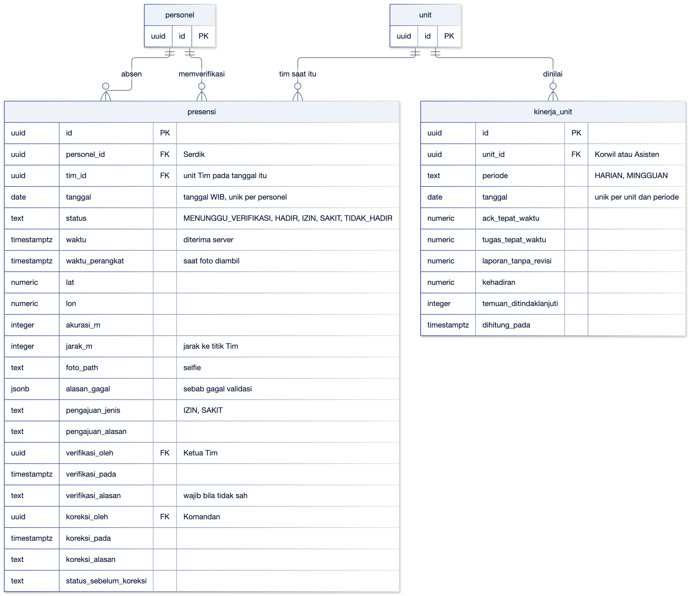

Sumber diagram (Mermaid)

<!-- erd:3-presensi-kinerja -->
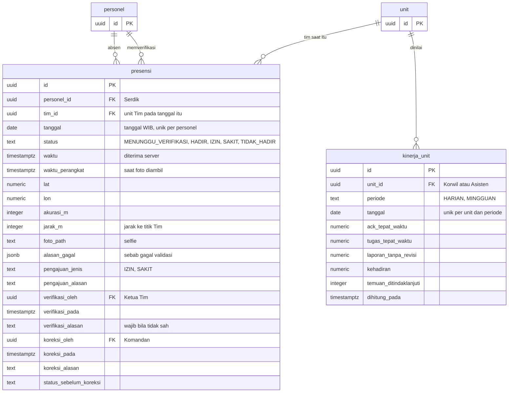

**Aturan penting**

- **Satu baris per Serdik per tanggal** (`personel_id` + `tanggal` unik). Belum ada baris berarti "Belum absen"; status itu tidak disimpan.
- **Lolos validasi langsung HADIR.** Gagal validasi (di luar geofence, akurasi buruk, di luar jendela jam, jam perangkat selisih lebih dari 10 menit) atau pengajuan izin/sakit menjadi MENUNGGU_VERIFIKASI, dengan sebabnya di `alasan_gagal`.
- **Batas jam check-in:** proses terjadwal membuat baris TIDAK_HADIR untuk Serdik yang belum punya baris hari itu.
- **Koreksi** hanya dengan izin `presensi.koreksi` (Komandan) dan alasan wajib. Riwayat lengkap ada di `log_audit`.
- **Rekap berjenjang** Tim → Sektor → Korwil → Satgas dihitung dari `presensi` lewat pohon `unit` (view), tidak disimpan sebagai tabel.
- **`kinerja_unit`** adalah hasil hitung berkala (T07). Modul ini belum dibangun di `yafidsa`; kolomnya diturunkan dari diagram T07.

## 4 · Penugasan & laporan (T02, T03, T07)

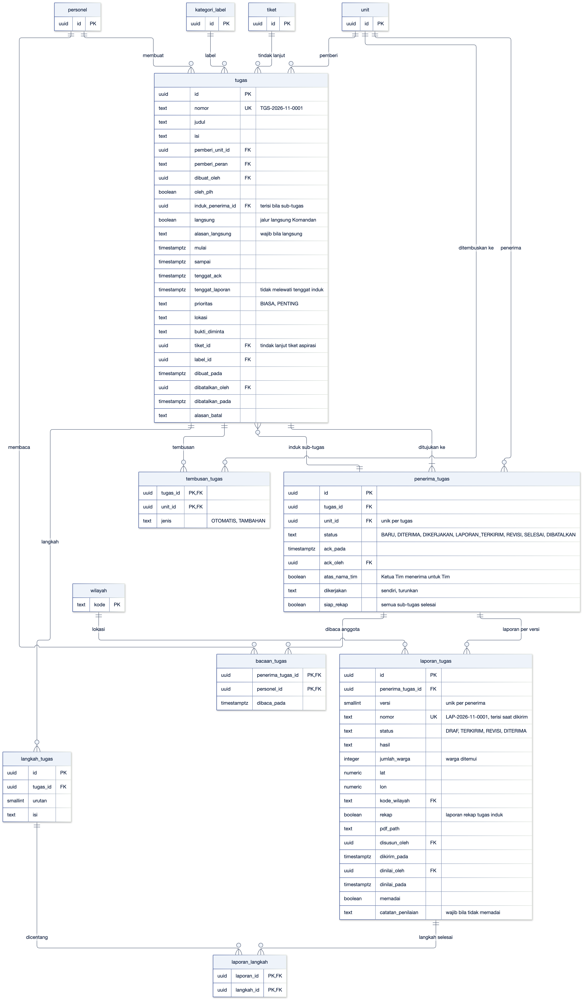

Sumber diagram (Mermaid)

<!-- erd:4-penugasan-laporan -->
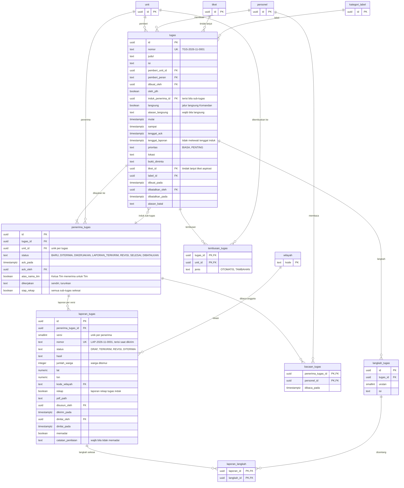

**Aturan penting**

- **Satu tugas bisa punya banyak penerima**, dan status dilacak per penerima di `penerima_tugas`, sama seperti di `yafidsa`.
- **Pemberi dan penerima adalah unit**, bukan orang. Siapa pun yang memegang unit itu melihat dan menindaklanjuti tugasnya.
- **Sub-tugas** menunjuk baris `penerima_tugas` induknya lewat `induk_penerima_id`. Rantai penugasan dan progres naik ditelusuri dari sini.
- **Validasi saat dibuat** (T02): pasangan peran pemberi–penerima ada di `matriks_penugasan`, penerima berada di dalam cakupan pemberi, `tenggat_laporan` tidak melewati tenggat induk maupun akhir `masa_penugasan`, dan `alasan_langsung` terisi bila jalur langsung.
- **Tembusan otomatis** disimpan di `tembusan_tugas` dan hanya bisa membaca. Penerimanya dihitung dari pohon `unit`: semua induk di atas unit pemberi, ditambah induk unit penerima yang dilewati pada jalur langsung. Contoh: Wakil Komandan → Korwil ditembuskan ke Komandan; Komandan → Ketua Tim ditembuskan ke Korwil dan Komandan Sektor di atas Tim itu.
- **`bacaan_tugas`** mencatat anggota Tim yang sudah membaca tugas untuk Tim.
- **Laporan dikunci per versi.** Mengirim memberi `nomor` dan PDF; penolakan (catatan wajib) mengubah laporan menjadi REVISI dan pelaksana membuat versi berikutnya. Versi lama tidak diubah.
- **Laporan diterima** mengubah penerima menjadi SELESAI. Bila semua sub-tugas dari satu induk selesai, `siap_rekap` pada penerima induk menyala dan pelaksana induk menyusun laporan `rekap`.
- **Tidak ada data pribadi warga.** Seperti di `yafidsa`, laporan hanya menyimpan jumlah warga yang ditemui.

## 5 · Aspirasi & koordinasi (T04, T06, T07)

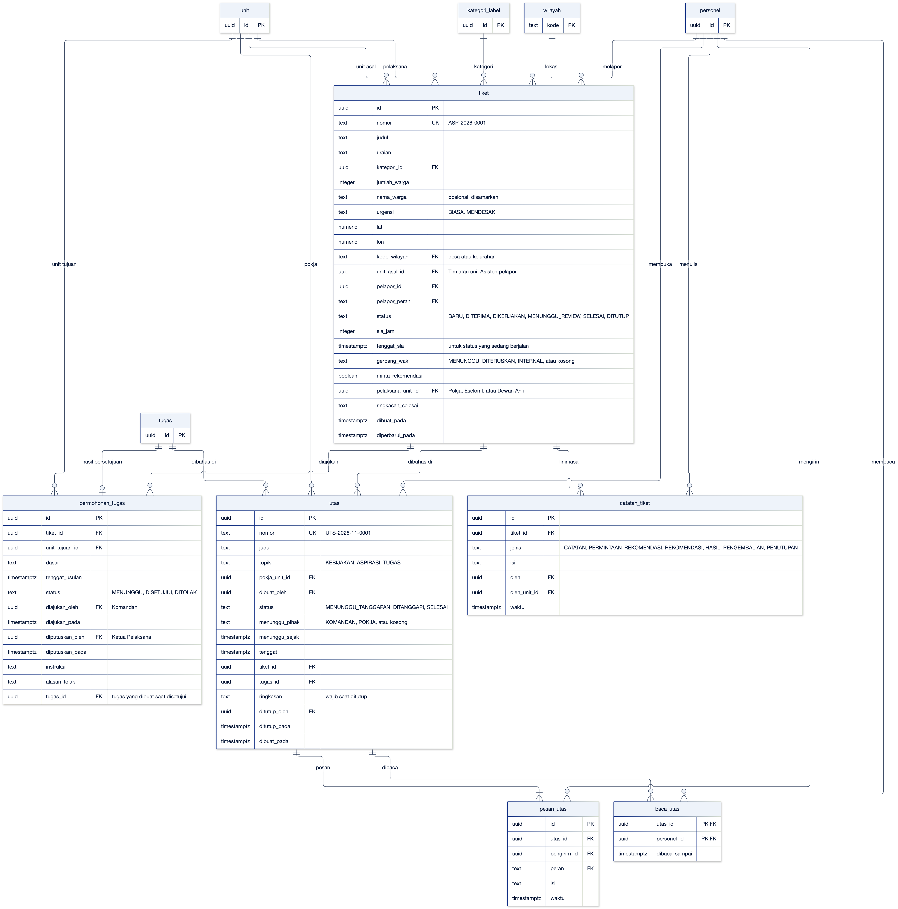

Sumber diagram (Mermaid)

<!-- erd:5-aspirasi-koordinasi -->
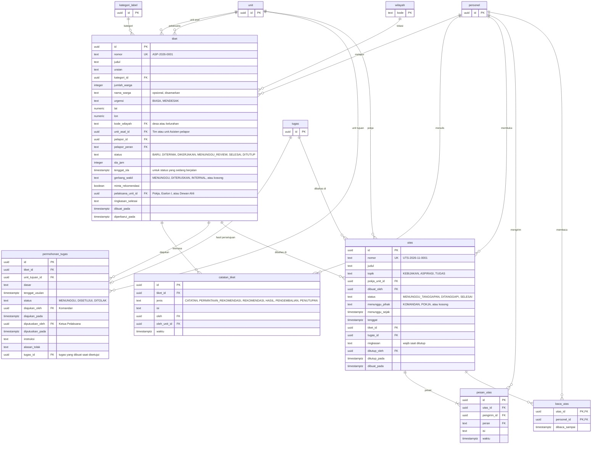

**Aturan penting**

- **Tiket dibuat Serdik, Ketua Tim, atau Asisten.** Temuan Asisten masuk dengan `gerbang_wakil = MENUNGGU`; Wakil Komandan memutuskan DITERUSKAN (menjadi tiket untuk Komandan) atau INTERNAL (T07).
- **Hanya Komandan (atau PLH)** yang menelaah, memilih jalur tindak lanjut, dan menyelesaikan tiket.
- **Dua jalur tindak lanjut** (T04): koordinasi langsung dengan Pokja lewat `utas`, atau `permohonan_tugas` ke Ketua Pelaksana untuk Eselon I, Dewan Ahli, atau K/L. Permohonan yang ditolak tetap tersimpan, dan Komandan bisa mengajukan yang baru.
- **Persetujuan permohonan** membuat `tugas` untuk unit tujuan, mengisi `pelaksana_unit_id`, dan mengubah tiket menjadi DIKERJAKAN.
- **`catatan_tiket`** menyatukan rekomendasi Dewan Ahli, hasil tindak lanjut, catatan pengembalian, dan alasan penutupan yang di `yafidsa` tersebar di beberapa daftar.
- **SLA dipantau di setiap status** lewat `tenggat_sla`; lewat tenggat memicu pengingat ke penanggung jawab serta Komandan dan Wakil Komandan.
- **Utas** hanya antara Komandan dan satu Pokja. Ketua Pelaksana membaca semua utas lewat izin `koordinasi.lihat`, jadi tembusannya tidak perlu tabel sendiri.
- **Menutup utas** mewajibkan `ringkasan`; bila utas terkait tiket, ringkasan itu ditambahkan sebagai `catatan_tiket` berjenis HASIL.
- **`nama_warga`** adalah satu-satunya data pribadi warga di skema ini; tampil hanya untuk peran yang berhak.

## 6 · Commander intent & pendukung

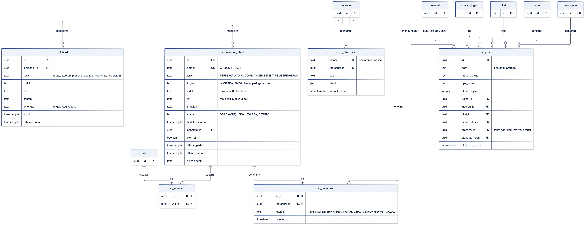

Sumber diagram (Mermaid)

<!-- erd:6-commander-intent-pendukung -->
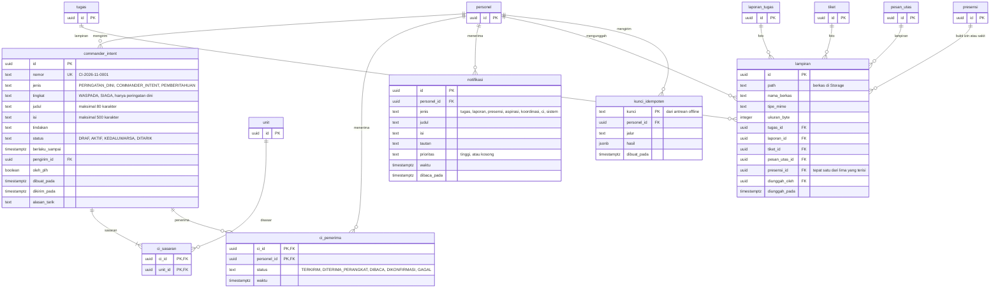

**Aturan penting**

- **Commander intent** hanya dikirim Komandan atau PLH. Modul ini ada di `yafidsa` tetapi tidak ada di diagram T01–T09.
- **Penerima dibekukan saat dikirim:** semua personel di bawah unit sasaran disalin ke `ci_penerima`, lalu statusnya naik dari TERKIRIM sampai DIKONFIRMASI.
- **Pesan Siaga atau lebih dari 50 penerima** wajib dikonfirmasi pengirim sebelum terkirim. Menarik pesan mewajibkan alasan.
- **`lampiran`** dipakai bersama; tepat satu kolom rujukan yang terisi. Laporan dan tiket paling banyak 6 foto.
- **`kunci_idempoten`** mencegah kiriman ganda dari antrean offline (check-in, pengajuan izin, terima tugas, laporan, tiket).
- **`notifikasi`** saat ini hanya di dalam aplikasi, sesuai `yafidsa`.

## Status

| Tabel | Nilai status | Diagram |
|---|---|---|
| `presensi` | MENUNGGU_VERIFIKASI → HADIR, IZIN, SAKIT, atau TIDAK_HADIR; koreksi antar keempatnya oleh Komandan | T01 |
| `penerima_tugas` | BARU → DITERIMA → DIKERJAKAN → LAPORAN_TERKIRIM → SELESAI atau REVISI; DIBATALKAN | T02, T03 |
| `laporan_tugas` | DRAF → TERKIRIM → DITERIMA atau REVISI | T03 |
| `tiket` | BARU → DITERIMA → DIKERJAKAN → MENUNGGU_REVIEW → SELESAI; DITERIMA → DITUTUP | T04 |
| `permohonan_tugas` | MENUNGGU → DISETUJUI atau DITOLAK | T04 |
| `utas` | MENUNGGU_TANGGAPAN ⇄ DITANGGAPI → SELESAI | T06 |
| `commander_intent` | DRAF → AKTIF → KEDALUWARSA atau DITARIK | `yafidsa` |
| `penetapan_peran` | DIJADWALKAN → AKTIF → BERAKHIR atau DICABUT | T09 |

## Pemetaan diagram ke tabel

| Diagram | Tabel utama |
|---|---|
| T01 Absensi Serdik | `presensi`, `unit` (geofence), `lampiran` |
| T02 Penugasan berjenjang | `tugas`, `penerima_tugas`, `tembusan_tugas`, `langkah_tugas`, `matriks_penugasan` |
| T03 Laporan tugas | `laporan_tugas`, `laporan_langkah`, `lampiran` |
| T04 Tiket aspirasi | `tiket`, `catatan_tiket`, `permohonan_tugas` |
| T06 Koordinasi Pokja | `utas`, `pesan_utas`, `baca_utas` |
| T07 Wakil Komandan & Asisten | `tiket.gerbang_wakil`, `kinerja_unit`, sub-tugas di `tugas` |
| T08 Dashboard & data master | `wilayah`, `unit`, `unit_wilayah`, `personel`, `kategori_label`, `impor_master`, `menu`, `peran_menu` |
| T09 Peran & hak akses | `peran`, `izin`, `peran_izin`, `penetapan_peran`, `penyesuaian_izin`, `penyesuaian_menu`, `log_audit` |
| UI Lupa password | `permintaan_reset_password` |

## Penyesuaian saat implementasi

Skema yang diterapkan (`dashboard-satgas-dialog/supabase/migrations/`) berbeda dari diagram di atas pada butir berikut. Diagram belum digambar ulang.

- **Tabel `berkas` (baru).** Isi foto dan lampiran disimpan di basis data (`bytea`), bukan di Supabase Storage, karena backend belum memegang secret key Supabase dan akses berkas harus sepenuhnya dikendalikan backend. Kolom `path` di `lampiran` menjadi `berkas_id`; `presensi.foto_path` menjadi `foto_berkas_id`; `laporan_tugas.pdf_path` menjadi `pdf_berkas_id`. Pindah ke Storage cukup mengganti `src/server/berkas.ts`.
- **Tabel `penomoran` (baru).** Penghitung nomor dokumen per jenis dan periode, dipakai fungsi `nomor_berikut()`.
- **`unit.leluhur` (baru).** Daftar id induk sampai akar, diisi pemicu; dasar perhitungan cakupan data.
- **Salinan nama.** `catatan_tiket.oleh_nama`, `pesan_utas.pengirim_nama`, dan `commander_intent.pengirim_nama` menyimpan nama saat kejadian, supaya riwayat tidak berubah bila personel diganti.
- **Kolom tambahan kecil:** `tiket.nama_lokasi`, `lampiran.urutan`, `penerima_tugas.diperbarui_pada`, `peran.urutan`, `presensi.dibuat_pada`, `laporan_tugas.dibuat_pada`.
- **`peran.unsur_wajib`** bertipe `text[]`, bukan `text`.
- **Pengamanan.** Semua tabel ber-RLS tanpa policy dan hak peran `anon`/`authenticated` dicabut. Seluruh akses data lewat backend, yang menegakkan izin dan cakupan di kode (bukan lewat kebijakan RLS seperti tertulis di kelompok 2).

## Keputusan

Diputuskan pada 15 November 2026.

1. **Wakil Komandan tetap boleh menugaskan Korwil**, di samping Komandan. Lihat isi awal `matriks_penugasan` di kelompok 2.
2. **Komandan boleh menugaskan langsung ke semua jenjang** rantai komando: Wakil Komandan, Korwil, Asisten, Komandan Sektor, Ketua Tim, dan Serdik.
3. **Tiga Katim belum dimasukkan**, tetapi skema sudah menyediakan tempatnya (jenis unit `katim`; peran, izin, dan matriks berupa data).
4. **Penyesuaian izin disediakan di dua tingkat** sambil menunggu arahan: paket default per peran (`peran_izin`, `peran_menu`) dan penyesuaian per personel (`penyesuaian_izin`, `penyesuaian_menu`). Bila kelak hanya satu yang dipakai, tabel yang lain bisa dibuang tanpa memengaruhi modul lain.

## Masih terbuka

1. **Alasan wajib pada jalur langsung.** Mengikuti `yafidsa`, penugasan Komandan yang melewati jenjang mewajibkan alasan. Ini belum dikonfirmasi; mengubahnya cukup lewat kolom `wajib_alasan`.
2. **Label untuk laporan.** T08 menyebut tipe label berlaku untuk tiket, laporan, dan tugas, tetapi `yafidsa` hanya memakainya di tiket. Skema ini memberi `label_id` opsional di `tugas`; laporan belum diberi label.
3. **`kinerja_unit`** diturunkan dari T07 saja. Rumus tiap angka perlu ditetapkan sebelum modul Kinerja dibangun.
